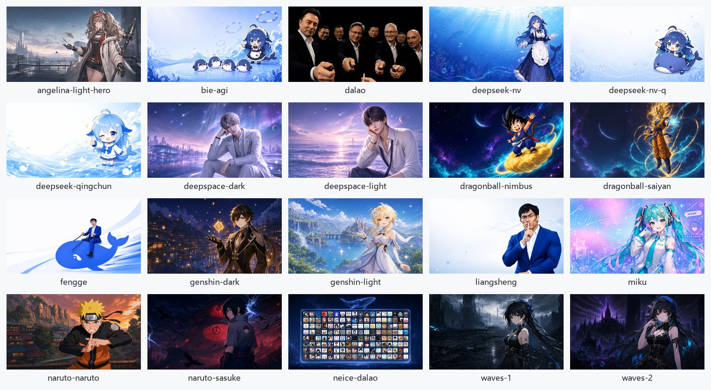
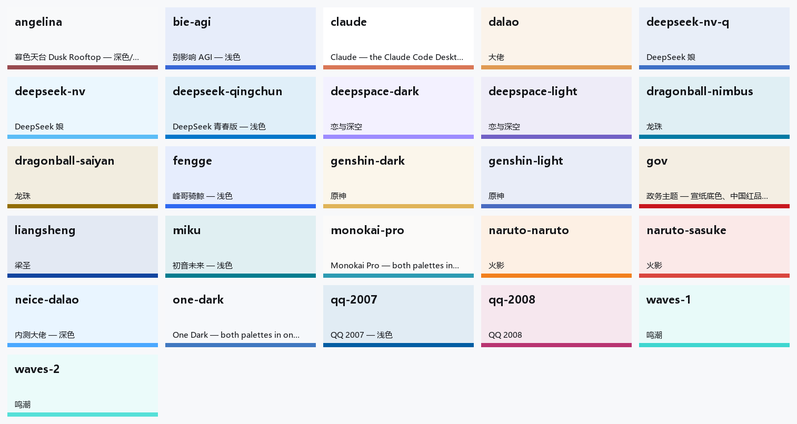

<div align="center">

# 🎨 DSH Custom Theme

**Elevate DeepSeek Harness with Bespoke Visuals and Modern Interactive Experiences**

User CSS Themes · Multi-Zone Wallpaper Workbench · Cosmic Particle Reasoning Slider · Line Spacing & Streaming Ink · Thought Disclosure Strategies

[](https://www.npmjs.com/package/dsh-custom-theme)
[](https://github.com/Sparrived/dsh-custom-theme/blob/main/LICENSE)
[](https://github.com/deepseek-ai/dsh)
[](https://github.com/Sparrived/dsh-custom-theme)
[](https://github.com/Sparrived/dsh-custom-theme/pulls)

**English** | [简体中文](README.md)

</div>

> **This is a personal fork**: 26 themes and 20 wallpapers are bundled on top of 0.8.0 and written into the local theme/background folders on first launch. Switching a theme also repaints the Global wallpaper — untick **Follow theme** in the background card to pin your own. Upstream project: [Sparrived/dsh-custom-theme](https://github.com/Sparrived/dsh-custom-theme). Install instructions in [Installation & Setup](#-installation--setup); asset credits in [CREDITS.md](CREDITS.md).

---

## 🌟 Overview

DeepSeek Harness natively provides only three fixed appearances: Light, Dark, and System, without an extensible user-facing styling system. **dsh-custom-theme** brings comprehensive visual personalization, comfort-oriented line spacing, and dynamic interactive enhancements to both the DSH Desktop application and the Web GUI:

- 🎨 **User-Editable CSS Theme Directory**: Drop any `.css` stylesheet into the theme folder for instant hot-reloading; includes bundled **Atom One Dark**, **Monokai Pro**, **Gov**, and **Claude** palettes.
- 🖼️ **Multi-Zone Wallpaper Workbench**: Segment the window into 6 distinct interactive visual regions (Global Viewport, Window Bar, Sidebar, Conversation Stream, Composer Seat, Dock Panel) with independent image, cover/contain sizing, positioning, opacity, and Gaussian blur controls.
- 🎞️ **Themes That Bring Their Own Wallpaper**: a theme names one with `/* @background: file.webp */`, or falls back to the `<theme id>-bg.webp` convention. The Global zone's **Follow theme** switch repaints on every theme change, picking a picture by hand pins it, and per-zone wallpapers keep working as before.
- 🌌 **Cosmic Starfield & Deep-Sea Reasoning Slider**: Replaces plain model menu rows with an interactive particle physics slider featuring **Codex Starfield** (22 phase-decorrelated drifting stars, dynamic nebula ramp, energy glow) and **DeepSeek Abyssal Whale** visual themes.
- ✍️ **Conversation Line Spacing**: Fine-grained line-height offsets (-2px–+6px) layered on top of the official text size, keeping long-form reading comfortable. Font size and font family follow the official General settings.
- 🏷️ **Custom Branding & CSS**: Replace the sidebar brand (wordmark, mark) and the welcome header (headline, badge, mark) outright, with three verbatim stylesheet boxes and stable `data-dct-*` hooks.
- 🌊 **Typewriter Streaming Fade-In & Ink Drop**: Smoothly fades in streaming text output to eliminate abrupt token jumpiness, with customizable fade duration and initial ink opacity.
- 💬 **Working Status Phrases & Shimmer Effects**: Rotate custom thinking phrases (e.g., "Deep-diving...", "Roaming the stars...", "Pondering...") with adjustable intervals; choose from Official sweep, Matte shimmer, Rainbow spectrum, Static, or Hidden modes.
- 🧠 **Automatic Reasoning Level Patching for 3rd-Party Models**: Automatically equips custom/third-party models in `cordis.patch.yml` that declare no effort levels with `off / low / high / max` controls, complete with byte-for-byte backup and rollback safety.
- 🔍 **Context Injections & Auto-Expand Modes**: Restores visibility for folded prompt/rule/skill injections; offers smart reasoning disclosure modes (`streaming`, `keep`, `always`, `off`).
- 🔥 **Start-Page Usage Heatmap**: Shows the last 26 weeks of local session usage between the greeting and the composer, with sessions, total tokens, active days, peak hour, and top model; switch between All / 30d / 7d or turn it off independently.
- ⚡ **Zero External Dependencies · Ultra-Lightweight**: Built entirely with native platform APIs, backed by 278 automated unit and Chromium CDP browser smoke tests for jitter-free rendering.

---

## 🖼️ This fork: 26 themes · 20 wallpapers

### The 20 wallpapers

<div align="center">
  
</div>

The file name minus `-bg.webp` is the theme id it ships with. Picking that theme repaints the Global zone with this picture; untick **Follow theme** in the Global card to pin your own — ad-hoc wallpaper switching keeps working either way. `angelina-light-hero.webp` is not original to this project: it comes from [bilbillm/deepseek-harness-angelina-themes](https://github.com/bilbillm/deepseek-harness-angelina-themes) (`src/assets/`), depicts Angelina from Arknights as unofficial fan art, and that project states its MIT licence does not cover the artwork — see [CREDITS.md](CREDITS.md).

### The 26 themes

<div align="center">
  
</div>

Each card uses the theme's surface colour, with its brand colour as the bottom strip. `gov`, `monokai-pro`, `one-dark`, `claude`, `qq-2007` and `qq-2008` ship without a wallpaper; picking them clears the Global wallpaper to a flat colour.

<details>
<summary><b>All 26 themes</b></summary>

| Theme id | Name | Source | Wallpaper |
| :--- | :--- | :--- | :--- |
| `angelina` | 暮色天台 Dusk Rooftop | Own palette · ported art | `angelina-light-hero.webp` |
| `bie-agi` | 别影响 AGI | Port | `bie-agi-bg.webp` |
| `claude` | Claude | Bundled upstream · frosted header | — |
| `dalao` | 大佬 | Port | `dalao-bg.webp` |
| `deepseek-nv` | DeepSeek 娘 | Port | `deepseek-nv-bg.webp` |
| `deepseek-nv-q` | DeepSeek 娘 · chibi | Port | `deepseek-nv-q-bg.webp` |
| `deepseek-qingchun` | DeepSeek 青春版 | Port | `deepseek-qingchun-bg.webp` |
| `deepspace-dark` | 恋与深空 · dark | Port | `deepspace-dark-bg.webp` |
| `deepspace-light` | 恋与深空 · light | Port | `deepspace-light-bg.webp` |
| `dragonball-nimbus` | 龙珠 · Nimbus | Port | `dragonball-nimbus-bg.webp` |
| `dragonball-saiyan` | 龙珠 · Saiyan | Port | `dragonball-saiyan-bg.webp` |
| `fengge` | 峰哥骑鲸 | Port | `fengge-bg.webp` |
| `genshin-dark` | 原神 · dark | Port | `genshin-dark-bg.webp` |
| `genshin-light` | 原神 · light | Port | `genshin-light-bg.webp` |
| `gov` | 政务主题 · rice paper | Bundled upstream · frosted header | — |
| `liangsheng` | 梁圣 | Port | `liangsheng-bg.webp` |
| `miku` | 初音未来 | Port | `miku-bg.webp` |
| `monokai-pro` | Monokai Pro | Bundled upstream · frosted header | — |
| `naruto-naruto` | 火影 · Naruto | Port | `naruto-naruto-bg.webp` |
| `naruto-sasuke` | 火影 · Sasuke | Port | `naruto-sasuke-bg.webp` |
| `neice-dalao` | 内测大佬 | Port | `neice-dalao-bg.webp` |
| `one-dark` | Atom One Dark | Bundled upstream · frosted header | — |
| `qq-2007` | QQ 2007 | Port | — |
| `qq-2008` | QQ 2008 | Port | — |
| `waves-1` | 鸣潮 · I | Port | `waves-1-bg.webp` |
| `waves-2` | 鸣潮 · II | Port | `waves-2-bg.webp` |

</details>

> The 21 ported skins come from [HeiGeAi/deepseek-harness-skin](https://github.com/HeiGeAi/deepseek-harness-skin) (MIT); attribution and licence details in [CREDITS.md](CREDITS.md).

---

## 📸 Visual Showcase & Features

### 1. Modernized Settings Panel & Theme Engine

In **Settings → Theme & Background (主题与背景)**, an intuitive card-based layout lets you manage color schemes, custom CSS palettes, and appearance options with zero configuration hassle.

<div align="center">
  
</div>

#### Bundled Themes in Action

<table>
  <tr>
    <td align="center" width="50%">
      <b>Atom One Dark</b><br />
      
    </td>
    <td align="center" width="50%">
      <b>Monokai Pro</b><br />
      
    </td>
  </tr>
  <tr>
    <td align="center" colspan="2">
      <b>Gov Terminal Dark</b><br />
      
    </td>
  </tr>
  <tr>
    <td align="center" width="50%">
      <b>Claude · Light</b><br />
      
    </td>
    <td align="center" width="50%">
      <b>Claude · Dark</b><br />
      
    </td>
  </tr>
</table>

---

### 2. Multi-Zone Wallpaper Workbench

The interface is deconstructed into 6 dedicated zones. You can paint a panoramic background across the entire window or configure bespoke wallpapers and frosted glass effects for individual panels.

<div align="center">
  
  <p><i>Click any region in the interactive window wireframe to adjust wallpaper image, opacity (0%–100%), and blur (0px–20px)</i></p>
</div>

#### Multi-Zone Real-World Rendering

Wallpapers are rendered through isolated `::before` pseudo-element layers, decoupled from the DOM layout flow. **Text contrast remains crystal-clear, and message streaming never incurs unnecessary repaints** — with one exception: the window bar is painted on the element's own background layers and creates no stacking context, so the popovers DSH mounts there (the background-jobs dropdown, for one) always stay above the conversation:

<div align="center">
  
</div>

---

### 3. Cosmic Starfield & Deep-Sea Reasoning Slider

In the model selector menu, the default static effort row is upgraded to an interactive, animated particle physics slider.

<div align="center">
  
</div>

<div align="center">
  
  <p><i>Codex Starfield: 22 phase-decorrelated drifting particles, nebula gradient fill, and dynamic energy ambience</i></p>
</div>

- **Dual Aesthetic Themes**: Switch between **Codex Starfield** (cosmic nebula & stars) and **DeepSeek Abyssal** (deep-sea cyan glow with a swimming whale track).
- **Silky Interactions**: Smooth continuous drag, magnetic tick-snapping, and full keyboard navigation (`Arrow keys` for steps, `Home`/`End` to jump).
- **Universal Sync**: Maps transparently across `off`, `low`, `high`, and `max`, directly updating the underlying model execution context.

---

### 4. Working Status Phrases & Shimmer Effects

When the AI model enters deep thought or runs tools, the working label transforms into a delightful, expressive display.

<div align="center">
  
</div>

- **Phrases Rotation**: Provide multiple custom lines, automatically rotating at your chosen interval (1.2s to 4s).
- **Visual Effects**:

| Effect Mode | Visual Appearance | Description |
| :--- | :--- | :--- |
| **Official** | Default blue-white sweep | Preserves DSH's clean standard sweep animation |
| **Matte Shimmer** | Solid text color with tinted band |  Elegant and subtle |
| **Rainbow Spectrum** | Continuous chromatic wave |  Vibrant and luminous |
| **Static** | Solid steady color, no animation | Distraction-free, zero animation overhead |
| **Hidden** | Collapsed bar | Completely hides visual bar while preserving screen reader accessibility |

---

### 5. Custom Branding: Sidebar Brand & Welcome Headline

A new **🏷️ Custom branding** card replaces the brand block in the sidebar's top-left corner and the welcome header with your own — no shell source changes involved.

| Region | What can be replaced | Left empty |
| :--- | :--- | :--- |
| **Sidebar brand** | Brand text (replacing the official `deepseek HARNESS` wordmark) | The official wordmark |
| | Brand mark image address (http/https or a `data:` picture) | The official whale mark |
| **Welcome header** | Headline text (replacing the official one) | The official headline |
| | Badge text (replacing the preview badge) | The official badge |
| | Mark image address (replacing the swimming whale) | The official swimming whale |
| **Custom CSS** | Sidebar brand / Welcome header / Page — three boxes | No rule is injected |

- Every field applies **as you type**, with no restart; clearing a box restores the official surface (to hide one, write `display: none`).
- The three stylesheet boxes are injected **verbatim**, in the order brand → headline → page, into this plugin's own `<style>`: target one region with its hook, or reach the whole app from the page box.
- The regions are located by their shell class-name suffixes (the brand block by `_brandIdentity`, the headline row by walking up from the preview badge inside it) and then marked with stable attributes, so a shell rebuild that rehashes its class names does not break your rules:

| Hook | Points at |
| :--- | :--- |
| `[data-dct-brand]` | The sidebar brand block (mark + wordmark) |
| `[data-dct-hero]` | The welcome headline row (headline + badge) |
| `[data-dct-hero-badge]` | The preview badge beside the headline |
| `[data-dct-brand-mark]`, `[data-dct-brand-name]` | The brand mark and wordmark you replaced |
| `[data-dct-hero-mark]` | The welcome mark you replaced |

For example, hiding the badge and turning the wordmark into a gradient, right inside the matching box:

```css
[data-dct-hero-badge] { display: none; }

[data-dct-brand] [data-dct-brand-name] {
  background: linear-gradient(90deg, #4f8cff, #a06bff);
  background-clip: text;
  color: transparent;
}
```

The same hooks are available in your own theme CSS (`themes/*.css`).

---

### 6. Start-Page Usage Heatmap

A standalone "Usage overview" card sits between the greeting and the composer: six stat cells — sessions, total tokens, active days, peak hour, daily tokens, and top model — above a 26-week token heatmap. The range switches between All / 30d / 7d for the stats while the grid keeps its 26-week window; every figure comes from the shell's local session-list projections, with no extra request and no log scan. The card comes after the greeting and before the workspace / mode row.

<div align="center">
  
</div>

Settings → Theme & background → Heatmap turns the card off on its own; when off it takes no space above the composer. The feature itself is still controlled by the `custom-theme-heatmap` row on the Plugins page.

---

### 7. Advanced Enhancements

| Feature | Details |
| :--- | :--- |
| **✍️ Line Spacing** | Fine-grained line height offsets (-2px–+6px) layered on top of the official text size, scaling with it automatically. Use the official General settings for font size and family. |
| **🌊 Streaming Fade-In** | Eliminates harsh jumping when new tokens arrive. Includes presets like *Fast*, *Soft*, and *Default* with adjustable transition time and ink opacity. |
| **🧠 Effort Level Auto-Patching** | Detects 3rd-party models in `cordis.patch.yml` that lack reasoning effort configurations and automatically supplies full `off/low/high/max` controls. |
| **🔍 Injected Context Restoral** | Restores visibility for folded Agent skills, workspace guidelines, and system injections into clean collapsible cards. |
| **🔥 Start-Page Usage Heatmap** | Draws local session tokens as a 26-week heatmap with six stat cells and All / 30d / 7d views; can be turned off on its own. |
| **📖 Reasoning Disclosure Modes** | Select from `streaming` (auto-expand during generation, auto-collapse upon finish), `keep` (stay expanded), `always`, or `off`. |
| **🔄 Seamless In-App Updates** | Background update checks against npm registries with a one-click upgrade button right inside Settings. |

---

## 📦 Installation & Setup

### This fork: install straight from GitHub

```powershell
& "$env:LOCALAPPDATA\Programs\DeepSeek Harness\resources\runtime\cli\bin\dsh.cmd" plugin --profile desktop add "github:elliotwilde0-arch/dsh-custom-themes-angelina"
```

- One command, no zip or USB stick: pnpm fetches this repo into the active profile.
- Repo name ≠ package name: the repo is `dsh-custom-themes-angelina`, the package is still `dsh-custom-theme` — DSH identifies plugins by package name, and renaming it would break the rows in `cordis.patch.yml`.
- Pin a version with a tag or commit, e.g. `github:elliotwilde0-arch/dsh-custom-themes-angelina#v0.8.0-rooftop.3`.
- Behind a proxy, set `$env:HTTPS_PROXY='http://127.0.0.1:7897'` before running it.

### Requirements

- **DeepSeek Harness** `0.2.1` or later.
- Compatible with **DSH Desktop** and **DSH Web GUI**.

### Method 1: Via DSH Plugin Manager (Recommended)

1. Launch DeepSeek Harness, and click **Plugins (插件)** in the left sidebar.
2. Search for `dsh-custom-theme` and click **Install**.
3. Restart DSH once; the **Theme & Background** section will appear in **Settings**.

### Method 2: Manual Configuration (`cordis.patch.yml`)

1. Install the package in your active DSH profile directory:
   ```bash
   pnpm add dsh-custom-theme
   ```

2. Register the plugin in `cordis.patch.yml`:
   ```yaml
   dsh-custom-theme:
     themesDir: ~/.dsh/themes
     backgroundsDir: ~/.dsh/backgrounds
   ```

3. Restart DSH Desktop or your `dsh web` service.

---

## 🎨 Authoring Custom CSS Themes

Creating a new theme is as simple as **dropping a `.css` file into the theme directory!**

### Directory Locations

- **Windows**: `C:\Users\<Username>\.dsh\themes\<theme-id>.css`
- **macOS / Linux**: `~/.dsh/themes/<theme-id>.css`

### Theme CSS Template

Simply override the `--dsw-alias-*` custom properties. The plugin extracts the palette and injects it into DSH's native theme runtime, automatically synthesizing matching Shiki syntax-highlighting tokens:

```css
/* ~/.dsh/themes/dracula-pro.css */

/* 1. Light / Default Palette */
:root {
  --dsw-alias-bg-base: #f8f8f2;
  --dsw-alias-bg-subtle: #eaeaea;
  --dsw-alias-brand-primary: #6272a4;
  --dsw-alias-label-primary: #282a36;
  --dsw-alias-label-secondary: #44475a;
  --dsw-alias-border-base: #d1d5db;
}

/* 2. Dark Palette (activates when switching to Dark mode) */
[data-theme="dark"] {
  --dsw-alias-bg-base: #282a36;
  --dsw-alias-bg-subtle: #1e1f29;
  --dsw-alias-brand-primary: #bd93f9;
  --dsw-alias-label-primary: #f8f8f2;
  --dsw-alias-label-secondary: #6272a4;
  --dsw-alias-border-base: #44475a;
}
```

After saving your file, open **Settings → Theme & Background** and click **Rescan (重新扫描)**. Your new theme will appear immediately!

<details>
<summary><b>🔍 Core CSS Custom Property Reference</b></summary>

| Property | Description |
| :--- | :--- |
| `--dsw-alias-bg-base` | Primary window and application background |
| `--dsw-alias-bg-subtle` | Secondary surface background (cards, sidebar, composer) |
| `--dsw-alias-brand-primary` | Main brand accent color (buttons, active states, focus rings) |
| `--dsw-alias-brand-hover` | Brand accent hover color |
| `--dsw-alias-label-primary` | Primary body text color |
| `--dsw-alias-label-secondary` | Secondary and descriptive label color |
| `--dsw-alias-border-base` | General container borders and dividers |
| `--dsw-alias-label-deep-diving` | Working label text color (e.g. "Deep-diving...") |
| `--dsw-alias-label-shimmer` | Shimmer sweep highlight color |

</details>

---

## 🖱️ Desktop tray (runtime patch)

After **every Desktop start** the plugin can inject the tray behavior into the running main process: a themed left-click session popup, the native right-click menu and double-click-to-open, with Unread / Recent / More, New chat, Open and Quit. It is memory-only: no installed file, launch argument, Electron fuse or elevation is touched, the patch disappears with the process, and switching it off restores the official tray immediately.

Requires the official Desktop (its Host is a child of the main process). Injection briefly opens a loopback debug port and closes it as soon as the patch is in place; keep the switch off if you do not accept that one-second window. Independent error badges and arbitrary old CSS are not ported; unread follows official in-memory state. Read [how it works, its security boundary and the real-machine verification](<docs/desktop-tray.md>).

---

## 🏛️ Architecture

`dsh-custom-theme` employs a decoupled two-tier architecture designed for maximum performance:

```
dsh-custom-theme/
├── src/
│   ├── index.mjs                # Host entry: Cordis row, serves /dsh-custom-theme/* routes
│   ├── host/                    # Host implementations (fs storage, AST patcher, updates)
│   ├── themes.mjs               # Pure theme rules (sanitization, MIME sniffing, bounds)
│   ├── effort-levels.mjs        # AST & text surgery on cordis.patch.yml
│   ├── update.mjs               # npm Registry client and cache manager
│   └── client/                  # Browser frontend source (modular CommonJS components)
├── lib/
│   └── client.js                # Bundled frontend module (lazy-loaded by DSH Web GUI)
├── themes/                      # Seeded stylesheets (one-dark, monokai-pro, gov, claude)
└── test/                        # Complete test suite: Unit tests + Real Chromium CDP browser tests
```

- **Strict Tier Isolation**: The Host half imports only `node:` builtins; the Browser half uses the shell's built-in React runtime without introducing external dependencies.
- **Additive Toward the Shell**: Custom branding occupies the brand seats the shell itself declares (shadowing the official occupant at a lower priority) and reuses its dictionary lookup — the official artwork is never copied and no shell component is rewritten.
- **Zero Paint Penalty**: Wallpapers run inside isolated pseudo-element stacking contexts with `requestAnimationFrame` batching, maintaining steady 60fps scrolling and streaming.

---

## 🧪 Testing & Verification

Every feature is rigorously verified through an automated test suite containing 278 tests:

```bash
# Run all unit tests and architectural boundary checks
pnpm test

# Run real-browser smoke tests (appearance, repaints, wallpaper persistence)
pnpm run test:browser

# Verify working label shimmer effects in Chromium
pnpm run test:effects
```

---

## 📄 License

This project is licensed under the [MIT License](LICENSE).

Feel free to open an [Issue](https://github.com/Sparrived/dsh-custom-theme/issues) or submit a [Pull Request](https://github.com/Sparrived/dsh-custom-theme/pulls) to contribute new themes and enhancements!
